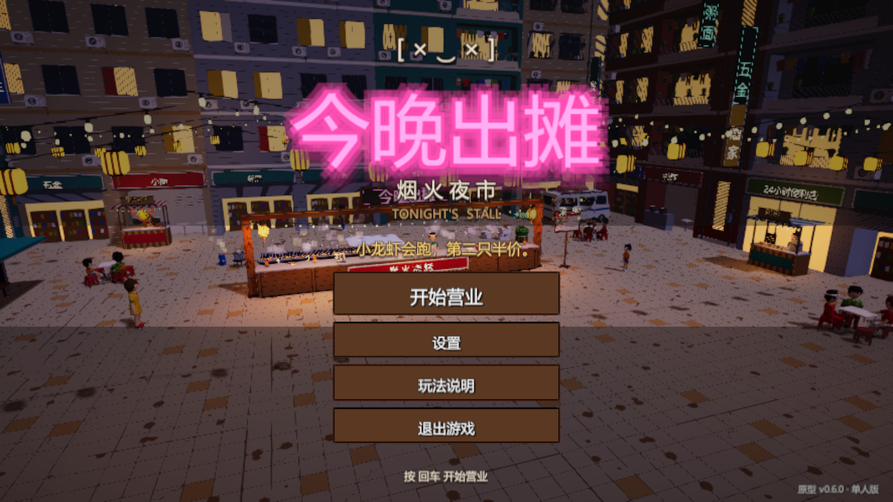
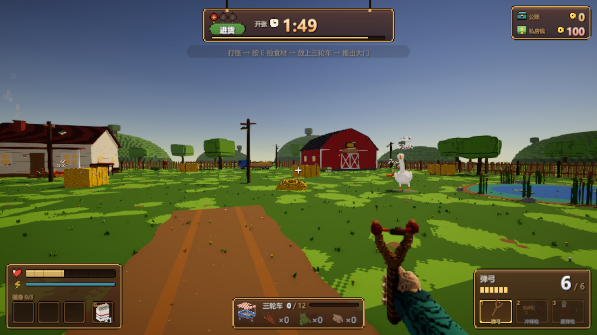

# 《今晚出摊》原型试玩版

> 末日夜市里，今晚的食材会自己跑。

一个搞笑荒诞的霓虹末日夜市小游戏（单人原型，体素画风）。你是夜市摊主：白天去牧场打"食材怪"进货，天黑后推着三轮车穿过街道赶回夜市，烤串、卖货、躲城管，撑过 3 个晚上的摊位费。

**这是早期原型**：美术、数值都还在调整。我们最想知道的是「进货 → 推车 → 出摊 → 结算」这个循环好不好玩。这一版特意调低了难度，希望你能完整玩完 3 晚再给反馈。

## 下载

👉 到右侧（手机上在页面下方）的 **Releases**，下载最新版本里的 **`今晚出摊_原型v0.6.0_Windows.zip`**。

- 系统：Windows 10 / 11，64 位
- 大小：约 88 MB（解压后约 172 MB）
- 只支持键盘 + 鼠标，界面只有中文

## 怎么开始

1. 把压缩包**整个解压**到任意文件夹（不要直接在压缩包里双击运行）。
2. 双击 `NightMarket.exe`。
3. 如果 Windows 弹出蓝色的「Windows 已保护你的电脑」：点「更多信息」→「仍要运行」。这是因为试玩版没有数字签名，不是病毒。
4. 压缩包里的 **`试玩说明（先看我）.txt`** 有完整的玩法、操作和反馈问题。

## 操作速查

| 按键 | 作用 |
|---|---|
| WASD / 鼠标 / 左键 | 移动 / 瞄准 / 开火 |
| Shift / 空格 | 跑（消耗体力）/ 跳 |
| E | 互动：捡食材、装车、推车、放烤架、取下、卖货、扔垃圾 |
| G | 扔面粉袋（烟雾挡视线；别扔到自己摊位上！） |
| F | 出摊时盖布躲城管 |
| R / 1 2 3 | 换弹 / 切换武器 |
| Esc | 暂停菜单 |
| F4 | 右上角性能信息（帧率等） |

游戏里的钱都是金币：**公账**（钱箱图标）用来交摊位费，**私房钱**（一沓现金图标）用来买东西，也是最终得分。

音量、亮度、灵敏度、视野、全屏 / 窗口、帧率、画质等都在开始界面或暂停菜单的 **「设置」** 里。电脑卡的话：设置 → 画质，把阴影调低、关掉湿地面反射。

## 反馈

玩完一局（或者玩到不想玩了）之后，请到本页上方的 **Issues** 新建一条，随便写几句就好：

1. 玩了多久？撑到第几晚？通关 / 失败的原因？
2. 最好玩和最无聊的分别是哪一段？
3. 难度怎么样？有没有看不懂、不知道该干什么的地方？屏幕上的图标能一眼看懂吗？
4. 操作手感、画面（人物、动物、武器的样子）有没有别扭或看不清的地方？
5. 遇到的 bug，以及当时在做什么。
6. 如果只能改一件事，你最想改什么？

游戏闪退时，可以把这个文件一起附上：`%USERPROFILE%\AppData\LocalLow\NightMarket Prototype\今晚出摊\Player.log`

## 已知问题

- 试玩版特意调低了难度，数值还在调整。
- 没有存档，一局大约 15～20 分钟。
- 只在少数电脑上测过，如果卡顿或风扇很响，请按 F4 看一下右上角的帧率并告诉我们。

## 素材来源

人物、动物、武器、场景都是我们自己用程序生成的体素模型。另外使用了以下 Unity 资源商店的免费素材（版权归各自作者）：

- Cartoon FX Remaster Free（Jean Moreno）
- FREE Casual Game SFX Pack（Dustyroom）
- Free Weapon Sound Effects（SoundLab_1）
- Breathtaking Vol 1 - Cyberpunk, Electro, Dark Synthwave Game Music Pack（Lufus）

用 Unity 6 制作。
