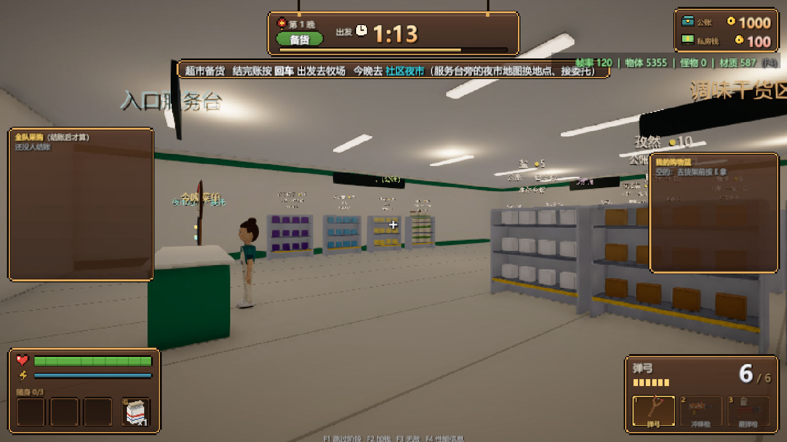
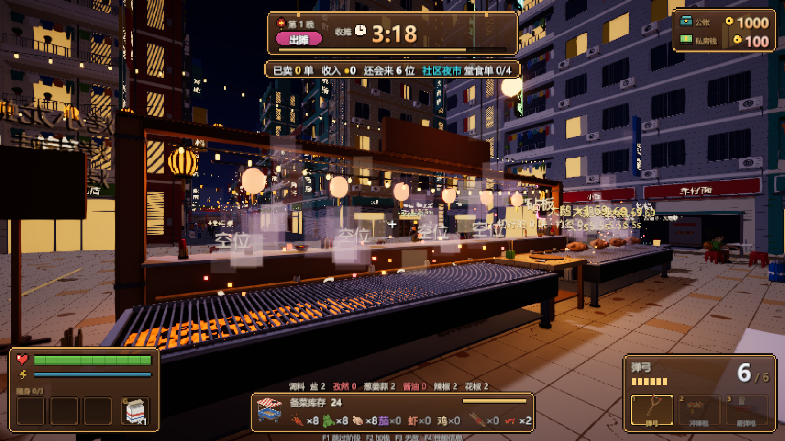
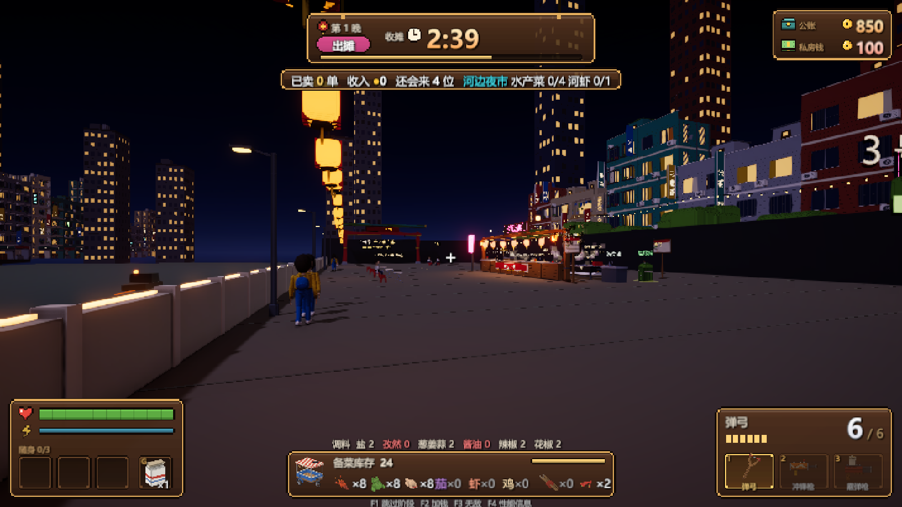

# 《今晚出摊》原型试玩版

> 末日夜市里，今晚的食材会自己跑。

一个搞笑荒诞的霓虹末日夜市小游戏（体素画风，单人或最多 6 人联机）。你是夜市摊主：傍晚走进超市备货，白天去牧场打"食材怪"、种菜养虾，天黑后回到摊位备菜、点单、烤串炒菜、躲城管，每晚交上摊位费。走完社区夜市 → 散场夜市 → 河边夜市的"夜市巡回"就通关。

**这是早期原型**：美术、数值都还在调整。v0.7.0 是一次大改（联机、超市、种养、新菜、堂食外带、三张街区地图、委托），新机制的数值还没调好，我们最想知道新的一晚流程好不好玩、乱不乱。

## 下载

👉 到右侧（手机上在页面下方）的 **Releases**，下载最新版本里的 **`今晚出摊_原型v0.7.0_Windows.zip`**。

- 系统：Windows 10 / 11，64 位
- 大小：约 90 MB（解压后约 177 MB）
- 只支持键盘 + 鼠标，界面只有中文
- 联机需要联网

## 怎么开始

1. 把压缩包**整个解压**到任意文件夹（不要直接在压缩包里双击运行）。
2. 双击 `NightMarket.exe`。
3. 如果 Windows 弹出蓝色的「Windows 已保护你的电脑」：点「更多信息」→「仍要运行」。这是因为试玩版没有数字签名，不是病毒。
4. 单人点「开始营业（单人）」；联机点「联机：创建 / 加入房间」，房主把邀请码发给朋友。
5. 压缩包里的 **`试玩说明（先看我）.txt`** 有完整的玩法、操作和反馈问题。

## 一晚的流程

| 阶段 | 做什么 |
|---|---|
| 备货 | 走进超市，货架拿东西、收银台结账；菜单板选今晚的菜；夜市地图选街区、接委托 |
| 进货 | 白天的牧场：打食材怪、装车，砍竹子削签，种植区 / 池塘区 / 养殖区照料和收成 |
| 备菜 | 摊位后厨：洗、切、穿串、分装，还没有客人 |
| 出摊 | 堂食 / 外带客人，先点单再做菜上菜；城管来了按 F 盖布；小心突发事件 |
| 结算 | 交摊位费；完成街区目标解锁下一站，委托领奖励；升级商店买设备 |

## 操作速查

| 按键 | 作用 |
|---|---|
| WASD / 鼠标 / 左键 | 移动 / 瞄准 / 开火 |
| Shift / 空格 | 跑（消耗体力）/ 跳 |
| E | 互动：按一下捡、装车、放烤架、取下、上菜；按住洗、切、穿串、点单、种地 |
| G | 扔面粉袋（烟雾挡视线；别扔到自己摊位上！） |
| F | 出摊时盖布躲城管 |
| 回车 | 就绪（备货、备菜时提前进入下一步） |
| R / 1 2 3 | 换弹 / 切换武器 |
| Esc | 暂停菜单 |
| F4 | 右上角性能信息（帧率等） |

游戏里的钱都是金币：**公账**全队共用，交摊位费、买调料种苗和设备；**私房钱**每人一个，小费归端菜的人，买武器道具，也是最终得分。

音量、亮度、灵敏度、视野、全屏 / 窗口、帧率、画质等都在开始界面或暂停菜单的 **「设置」** 里。电脑卡的话：设置 → 画质，把阴影调低。

## 反馈

玩完（或者玩到不想玩了）之后，请到本页上方的 **Issues** 新建一条，随便写几句就好：

1. 玩了多久？撑到第几晚、到了哪个街区？单人还是联机（几个人）？
2. 最好玩和最无聊的分别是哪一段？一晚的流程会不会太长、太碎？
3. 难度怎么样？有没有看不懂、不知道该干什么的地方（比如菜怎么做、委托怎么接、新菜怎么解锁）？
4. 联机的话：分工顺不顺？有没有卡顿、不同步、掉线？
5. 遇到的 bug，以及当时在做什么。
6. 如果只能改一件事，你最想改什么？

游戏闪退时，可以把这个文件一起附上：`%USERPROFILE%\AppData\LocalLow\NightMarket Prototype\今晚出摊\Player.log`

## 已知问题

- 新机制的数值都还没调，可能偏难或偏简单。
- 联机第一次创建 / 加入房间要等几秒；联机时存档在房主电脑上。
- 只在少数电脑上测过，如果卡顿或风扇很响，请按 F4 看一下右上角的帧率并告诉我们。

## 素材来源

人物、动物、武器、场景都是我们自己用程序生成的体素模型。另外使用了以下 Unity 资源商店的免费素材（版权归各自作者）：

- Cartoon FX Remaster Free（Jean Moreno）
- FREE Casual Game SFX Pack（Dustyroom）
- Free Weapon Sound Effects（SoundLab_1）
- Breathtaking Vol 1 - Cyberpunk, Electro, Dark Synthwave Game Music Pack（Lufus）

用 Unity 6 制作。
